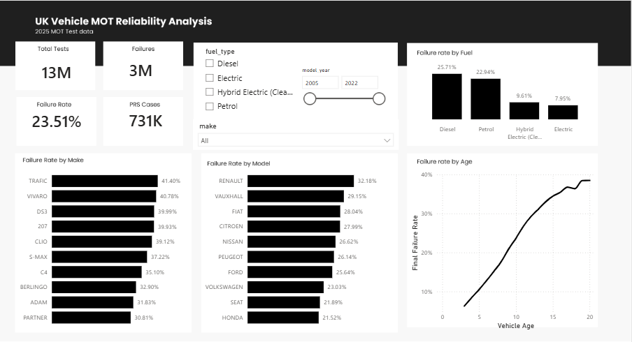

# UK Vehicle MOT Reliability Analysis (2025)

## Project Overview

Vehicle reliability is an important consideration for vehicle owners, fleet operators, automotive businesses, and maintenance providers.

This project analyses anonymised UK MOT test data for 2025 to investigate how final MOT failure rates vary across manufacturers, vehicle models, vehicle age, mileage, and fuel types.

Using **PostgreSQL** for data validation and analysis and **Microsoft Power BI** for interactive visualisation, the project identifies patterns in MOT outcomes and translates them into insights that can support automotive and fleet management decisions.

The analysis focuses on understanding differences in failure rates across vehicle characteristics rather than simply ranking manufacturers.
## Dashboard Preview


## Business Questions

The analysis was guided by the following questions:

1. Which manufacturers record the highest and lowest final MOT failure rates?
2. Which vehicle models have relatively high failure rates?
3. How does vehicle age relate to MOT failure rates?
4. How do failure rates vary across mileage categories?
5. Are there differences in failure rates across fuel types?
6. Which combinations of manufacturer, model, age, and mileage record particularly high failure rates?

## Tools and Technologies

- **PostgreSQL:** Data validation, aggregation, and exploratory analysis.
- **SQL:** Data quality checks, joins where applicable, grouping, filtering, and analytical queries.
- **Microsoft Power BI:** Dashboard development and data visualisation.
- **DAX:** Measures and calculated columns for interactive analysis.

## Dataset Overview

The dataset contains 2,000 aggregated vehicle cohorts from anonymised UK MOT test results for 2025.

| Characteristic | Description |
|---|---|
| Records | 2,000 |
| Manufacturers | 20 |
| Vehicle models | 163 |
| Fuel types | 4 |
| Model years | 2005–2022 |
| Data year | 2025 |

### Key Variables

| Variable | Description |
|---|---|
| `make` | Vehicle manufacturer |
| `model` | Vehicle model |
| `fuel_type` | Vehicle fuel classification |
| `model_year` | Vehicle model year |
| `mileage_band` | Vehicle mileage category |
| `tests` | Number of MOT tests |
| `passes` | Number of tests passed |
| `final_failures` | Number of final test failures |
| `prs` | Number of Pass after Rectification at Station outcomes |
| `initial_failure_rate` | Initial failures, including PRS, divided by total tests |
| `final_failure_rate` | Final failures divided by total tests |
| `median_mileage` | Approximate median mileage for the cohort |

### Mileage Categories

- 0–30,000 miles
- 30,000–60,000 miles
- 60,000–90,000 miles
- 90,000–120,000 miles
- 120,000 miles and above

## Data Preparation and Quality Checks

The dataset was imported into PostgreSQL for validation and analysis.

The following checks were performed:

- Record count verification.
- Missing-value checks.
- Duplicate cohort checks.
- Test outcome consistency checks.
- Model-year range validation.

The dataset contained no missing values or duplicate cohort combinations.

All records satisfied the outcome consistency condition:

`tests = passes + final_failures + prs`

This confirmed that the recorded test outcomes reconciled with the total number of tests.

## Analytical Methodology

The analysis was conducted using PostgreSQL.

### 1. Manufacturer Analysis

Aggregated test volumes and final failures by manufacturer to calculate weighted final failure rates.

### 2. Model Analysis

Compared vehicle models using aggregated test volumes and final failure rates. A minimum threshold of 1,000 tests was applied to reduce the influence of small denominators.

### 3. Vehicle Age Analysis

Calculated approximate vehicle age using:

`Vehicle Age = 2025 - model_year`

Failure rates were compared across vehicle age groups.

### 4. Mileage Analysis

Grouped vehicles into mileage categories and calculated the corresponding weighted final failure rates.

### 5. Fuel Type Analysis

Compared failure rates across diesel, petrol, hybrid electric, and electric vehicles.

### 6. Combined Cohort Analysis

Examined combinations of manufacturer, model, fuel type, model year, and mileage band to identify cohorts with particularly high failure rates. Only cohorts with at least 1,000 tests were included.

### Primary Metric

The main performance metric was the weighted final failure rate:

`Final Failure Rate = Total Final Failures / Total Tests × 100`

Weighted rates were used instead of averaging individual cohort percentages because the cohorts have different test volumes.

## Key Findings

### 1. Manufacturer-Level Failure Rates

| Manufacturer | Tests | Final Failure Rate |
|---|---:|---:|
| Renault | 271,262 | 32.18% |
| Vauxhall | 1,634,435 | 29.15% |
| Fiat | 271,812 | 28.04% |
| Citroen | 259,563 | 27.99% |
| Nissan | 911,348 | 26.62% |
| Toyota | 698,313 | 15.34% |

Renault recorded the highest manufacturer-level final failure rate at 32.18%, while Toyota recorded the lowest at 15.34%.

This represents a difference of 16.84 percentage points.

Ford recorded the highest test volume, with 2,857,378 tests and a final failure rate of 25.64%.

### 2. Model-Level Failure Rates

| Manufacturer | Model | Tests | Final Failure Rate |
|---|---|---:|---:|
| Renault | Trafic | 15,360 | 41.40% |
| Vauxhall | Vivaro | 93,040 | 40.78% |
| Citroen | DS3 | 11,696 | 39.99% |
| Peugeot | 207 | 41,910 | 39.93% |
| Renault | Clio | 153,639 | 39.12% |

Renault Trafic recorded the highest failure rate among the models in the filtered comparison.

The results also demonstrate that failure patterns can differ considerably between models from the same manufacturer.

### 3. Vehicle Age and Failure Rates

| Vehicle Age | Final Failure Rate |
|---|---:|
| 3 years | 6.30% |
| 5 years | 10.51% |
| 10 years | 23.65% |
| 15 years | 34.43% |
| 20 years | 38.45% |

Failure rates generally increased with vehicle age.

Vehicles approximately 3 years old recorded a 6.30% failure rate, compared with 38.45% among vehicles approximately 20 years old.

### 4. Mileage and Failure Rates

| Mileage Category | Final Failure Rate |
|---|---:|
| 0–30k | 8.19% |
| 30–60k | 16.86% |
| 60–90k | 26.35% |
| 90–120k | 32.23% |
| 120k+ | 32.84% |

Failure rates generally increased across mileage categories.

The difference between the lowest and highest mileage categories was 24.65 percentage points.

However, the increase became smaller between the 90–120k and 120k+ categories.

### 5. Fuel Type and Failure Rates

| Fuel Type | Tests | Final Failure Rate |
|---|---:|---:|
| Diesel | 4,526,332 | 25.71% |
| Petrol | 8,121,267 | 22.94% |
| Hybrid Electric (Clean) | 361,509 | 9.61% |
| Electric | 20,954 | 7.95% |

Diesel vehicles recorded the highest final failure rate at 25.71%, while electric vehicles recorded the lowest at 7.95%.

However, the electric category had a considerably smaller test volume than petrol and diesel.

### 6. High-Failure Vehicle Cohorts

The combined cohort analysis revealed recurring patterns among older, high-mileage vehicles.

| Manufacturer | Model | Year | Mileage | Final Failure Rate |
|---|---|---:|---|---:|
| Nissan | Qashqai | 2009 | 120k+ | 51.85% |
| Nissan | Qashqai | 2010 | 120k+ | 49.88% |
| Nissan | Qashqai | 2011 | 120k+ | 49.72% |
| Volkswagen | Polo | 2006 | 120k+ | 49.59% |
| Renault | Clio | 2008 | 90–120k | 48.82% |

Nissan Qashqai diesel cohorts appeared repeatedly among the highest-rate groups.

This highlights the importance of examining vehicle characteristics together rather than independently.

An interactive Power BI dashboard was developed to communicate the findings.

### Key Performance Indicators

- Total MOT Tests
- Total Final Failures
- Overall Final Failure Rate
- Total PRS Cases

### Visualisations

1. Top 10 manufacturers by final failure rate.
2. Top 10 vehicle models by final failure rate.
3. Final failure rate by vehicle age.
4. Final failure rate by mileage category.
5. Final failure rate by fuel type.

### Interactive Filters

- Manufacturer
- Fuel type
- Model year

The dashboard enables users to explore the results across different vehicle segments.

## Business Recommendations

Based on the observed patterns, the following recommendations can be considered:

1. **Improve maintenance planning:** Fleet operators can incorporate vehicle age and mileage into preventive maintenance schedules.
2. **Monitor model-level performance:** Automotive businesses can investigate models and cohorts with consistently higher failure rates.
3. **Combine vehicle characteristics:** Manufacturer-level comparisons should be complemented by model, age, and mileage analysis.
4. **Consider sample sizes:** Categories with relatively few tests should be interpreted cautiously.
5. **Investigate recurring high-failure cohorts:** Further analysis could identify the specific failure categories responsible for the observed patterns.

## Limitations

The findings should be interpreted within the context of the dataset.

- The dataset contains aggregated cohorts rather than individual vehicle records.
- The 2,000 records represent selected large cohorts and do not cover every UK vehicle or manufacturer.
- The analysis uses test counts, not unique vehicle counts.
- Fuel-type classifications may contain inaccuracies, particularly for some hybrid vehicles.
- The analysis identifies associations, not causal relationships.
- Vehicle age and mileage may be related, making it difficult to isolate their individual effects.
- The electric vehicle category has a much smaller test volume than petrol and diesel categories.

Consequently, the results should not be interpreted as definitive rankings of inherent vehicle reliability.

## Conclusion

This project demonstrates how structured data analysis can turn aggregated vehicle inspection records into meaningful business insights.

The analysis identified considerable variation in final MOT failure rates across manufacturers, models, vehicle age, mileage, and fuel types.

The strongest patterns observed were the higher failure rates associated with older and higher-mileage vehicle cohorts, alongside substantial differences between manufacturers and individual models.

By combining SQL-based analysis with an interactive Power BI dashboard, the project demonstrates how data can be used to investigate business questions, identify patterns, and support more informed decision-making.

---

## Project Structure

```text
uk-vehicle-mot-reliability-analysis/
│
├── README.md
│
├── data/
│   ├── mot_reliability_cohorts_2025_sample.csv
│   └── data_dictionary.csv
│
├── UK_Vehicle MOT.pbix
│  
├── dashboard_preview.png
│ 
└── mot_reliability_analysis.sql
```
